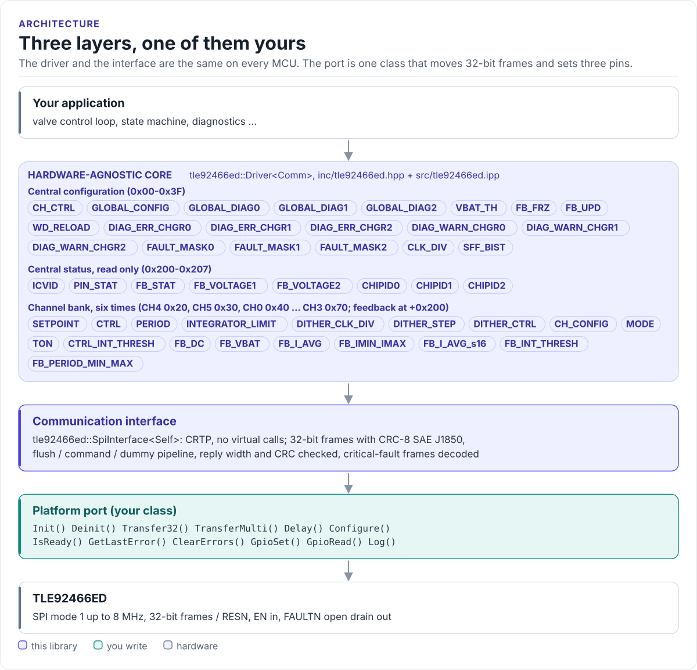

# TLE92466ED Driver

A C++20 driver for the Infineon TLE92466ED six-channel low-side solenoid driver: configure current control, PWM
and dither, regulate coil currents and read feedback and diagnostics, from any MCU with SPI.

[](https://github.com/hardfoc/hf-tle92466ed-driver/actions/workflows/ci-host-tests.yml)
[](https://github.com/hardfoc/hf-tle92466ed-driver/actions/workflows/esp32-examples-build-ci.yml)
[](https://hardfoc.github.io/hf-tle92466ed-driver/)
[](LICENSE)

**Documentation: <https://hardfoc.github.io/hf-tle92466ed-driver/>**

<!-- figure: driver-layers -->
<picture>
  <source media="(prefers-color-scheme: dark)" srcset="docs/diagrams/driver-layers.dark.svg">
  
</picture>
<!-- /figure -->

## In 30 seconds

Write a small port class for your MCU (a 32-bit SPI transfer, RESN, EN, FAULTN and a delay;
[Porting](https://hardfoc.github.io/hf-tle92466ed-driver/latest/porting/)), then:

<!-- generated: quickstart-code -->
```cpp
#include "tle92466ed.hpp"

int drive_ch0_at_500_ma(MySpi& spi) {
  using tle92466ed::Channel;
  tle92466ed::Driver<MySpi> driver(spi);

  if (!driver.Init()) {                                       // 1. reset, ICVID, Config Mode
    return -1;                                                //    VDD, wiring, SPI mode 1
  }
  if (!driver.ConfigurePwmPeriod(Channel::CH0, 1000.0F) ||    // 2. 1 kHz PWM,
      !driver.ConfigureDither(Channel::CH0, 50.0F, 100.0F)) { //    50 mA dither at 100 Hz
    return -2;
  }
  if (!driver.EnterMissionMode() ||                           // 3. outputs can switch
      !driver.SetCurrentSetpoint(Channel::CH0, 500) ||        // 4. regulate 500 mA
      !driver.EnableChannel(Channel::CH0, true)) {
    return -3;
  }
  return 0;
}
```
<!-- /generated -->

## What it does

- Brings the chip up (`Init()`): RESN pulse, `ICVID` check, defaults, Config Mode; then Mission Mode on request.
- Sets current setpoints in mA or µA with the datasheet's 15-bit scaling, single channels and parallel pairs.
- Configures PWM period and dither per channel, and starts the measurement clock the feedback depends on.
- Reads average current, duty cycle and supplies, including a non-blocking batch read for control loops.
- Decodes every fault (supplies, temperature, open load, short to ground, over-current) into one report.
- Talks SPI the way the datasheet specifies: 32-bit frames, CRC-8 SAE J1850, a self-synchronising pipeline and
  validated replies.
- No heap, no exceptions, no RTOS, no virtual calls (the port is a CRTP class).

## Install

```bash
git submodule add https://github.com/hardfoc/hf-tle92466ed-driver.git external/hf-tle92466ed-driver
```

```cmake
add_subdirectory(external/hf-tle92466ed-driver)
target_link_libraries(my_app PRIVATE hf_tle92466ed)
```

ESP-IDF: use the component wrapper in [`examples/esp32/components/hf_tle92466ed`](examples/esp32/components/hf_tle92466ed/CMakeLists.txt).
Details: [Installation](https://hardfoc.github.io/hf-tle92466ed-driver/latest/installation/).

## Documentation

| | |
| --- | --- |
| [Quickstart](https://hardfoc.github.io/hf-tle92466ed-driver/latest/quickstart/) | Wire it, write the port, drive a channel |
| [Hardware](https://hardfoc.github.io/hf-tle92466ed-driver/latest/hardware/) | Pins, supplies, bus settings, timing, evaluation kit |
| [SPI protocol](https://hardfoc.github.io/hf-tle92466ed-driver/latest/spi-protocol/) | Frames, CRC, the reply pipeline, fault frames |
| [API guide](https://hardfoc.github.io/hf-tle92466ed-driver/latest/api-guide/) | Configure, drive, read, handle errors |
| [Examples](https://hardfoc.github.io/hf-tle92466ed-driver/latest/examples/) | ESP32-S3 applications |
| [API reference](https://hardfoc.github.io/hf-tle92466ed-driver/latest/api/) | Doxygen, every class and member |

The pages are in [`docs/`](docs/index.md); the datasheets are in [`docs/datasheet/`](docs/datasheet/).

## Tests

```bash
cmake -S . -B build-host -DHF_TLE92466ED_BUILD_TESTS=ON && cmake --build build-host && ctest --test-dir build-host
```

The host tests run the driver against a register model of the chip; the code on the documentation site is compiled
by the same build.

## License

GPL-3.0. See [LICENSE](LICENSE).
