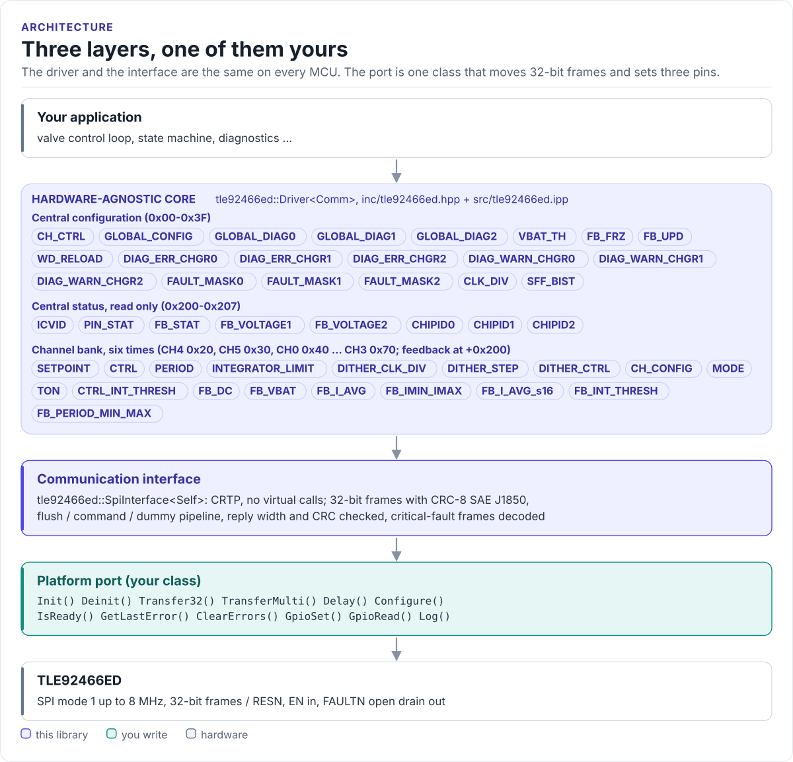
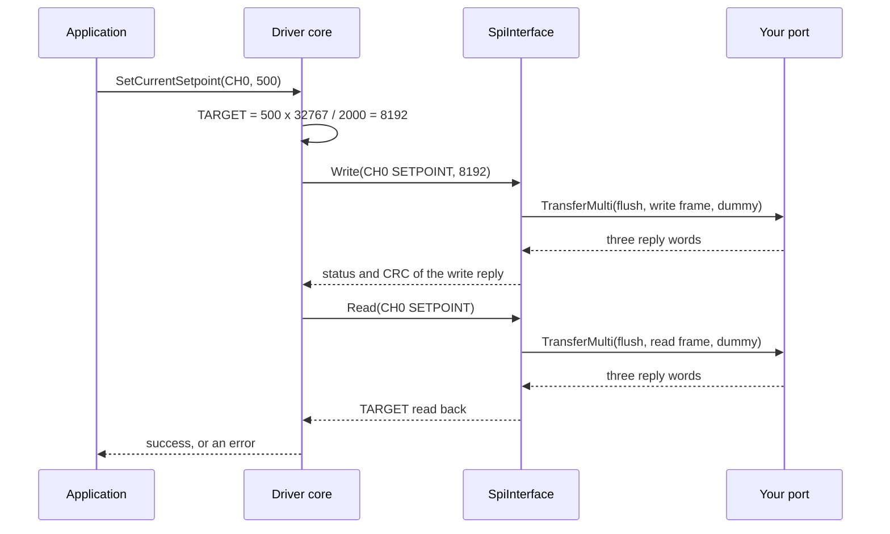

# Architecture

How the driver is put together: three layers, what each owns, and how one call reaches the chip.

<!-- figure: driver-layers -->
<picture>
  <source media="(prefers-color-scheme: dark)" srcset="diagrams/driver-layers.dark.svg">
  
</picture>
<!-- /figure -->

## The three layers

| Layer | Where | Depends on | You change it when |
| --- | --- | --- | --- |
| **Hardware-agnostic core**: `Driver<Comm>` | [`inc/tle92466ed.hpp`](../inc/tle92466ed.hpp), [`src/tle92466ed.ipp`](../src/tle92466ed.ipp), [`inc/tle92466ed_registers.hpp`](../inc/tle92466ed_registers.hpp) | The interface's methods only | Never, for a new board |
| **Communication interface**: `SpiInterface<Self>` | [`inc/tle92466ed_spi_interface.hpp`](../inc/tle92466ed_spi_interface.hpp) | Twelve methods of your port | Never |
| **Platform port**: your class | Your project | Your SDK | Once per MCU or board ([Porting](porting.md)) |

Everything above the port is the same on ESP32, STM32, a Linux host or the unit-test model. That is how the
[host tests](testing.md) run the real driver code without hardware.

## What each layer owns

- **The core** knows the chip: the register map and bit fields, Config and Mission Mode, the channel bank
  addresses, setpoint and PWM scaling, the feedback decoding and the fault report. It caches what the chip does
  not read back reliably (the channel-enable bits of `CH_CTRL`) and checks the mode before calls that need one.
- **The interface** knows the bus protocol: it builds the 32-bit frames, adds the CRC byte, sends the
  flush / command / dummy sequence, checks each reply's CRC and width, and records critical-fault frames. It also
  offers `ReadMulti()`, a pipelined burst of up to 12 reads.
- **The port** knows your hardware: how to clock 32 bits with CSN, how to set two GPIOs and read one, how to wait
  and where log lines go.

## How one call reaches the chip

`SetCurrentSetpoint()` reads the setpoint back and retries a write that did not land, up to three times.

## Why CRTP

The interface is a class template parameter, not a virtual base class. The compiler sees your port's methods
directly and inlines them; the driver has no vtable, allocates nothing and needs no RTTI. The cost is that the
driver type names the port: `Driver<MySpi>`. Code that has to work with several port types takes the driver as a
template parameter too.

## Errors without exceptions

Every call returns `DriverResult<T>`, an `expected<T, DriverError>`: `std::expected` on C++23, a small polyfill
on C++20. The interface returns `CommResult<T>` with a `CommError`, which the core maps to a `DriverError`
(`NoReply` to `DeviceNotResponding`, a critical-fault frame to `FaultDetected`, and so on). The
[API guide](api-guide.md#errors) lists them.

## Source map

| Path | Contents |
| --- | --- |
| `inc/tle92466ed.hpp` | `Driver<Comm>`, configuration and status structures, `DriverError` |
| `src/tle92466ed.ipp` | Template implementation, included by the header |
| `inc/tle92466ed_spi_interface.hpp` | `SpiInterface<Self>`, `SPIFrame`, reply modes and status codes, `CtrlPin`, `CommError` |
| `inc/tle92466ed_registers.hpp` | Register addresses, bit fields, scaling helpers, CRC-8 |
| `inc/tle92466ed_expected.hpp` | `expected` / `unexpected` for C++20 |
| `tests/` | Host unit tests and the compiled documentation snippets |
| `examples/esp32/` | ESP-IDF applications for the ESP32-S3 |

Next: [SPI protocol](spi-protocol.md).
