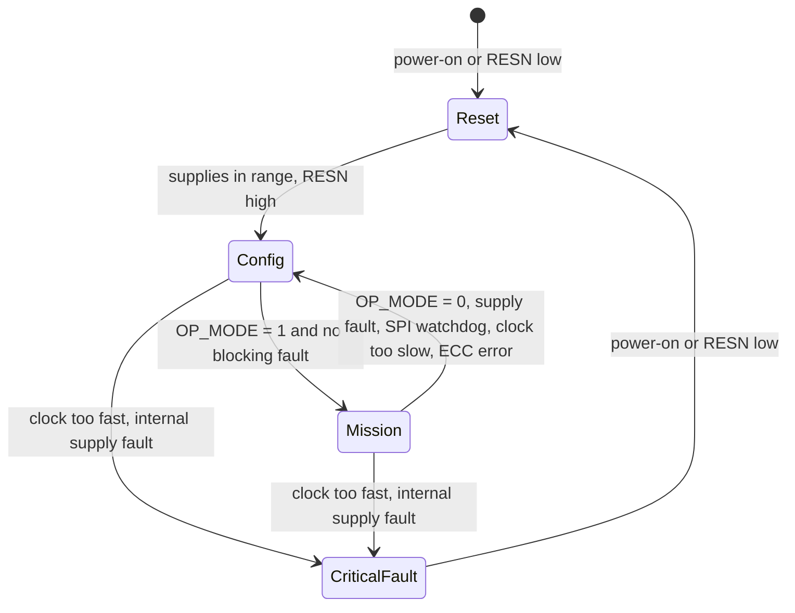

# Diagnostics and faults

The chip's operation states, what it monitors, how faults reach FAULTN and the registers, and how the driver
reports them.

Section references are to the [datasheet](datasheet/tle92466ed-datasheet.pdf) (Rev. 1.2).

## Operation states



| State | What works | Driver |
| --- | --- | --- |
| Reset | SPI answers with 16-bit replies; registers return to their defaults on exit | `HoldReset()` / `ReleaseReset()`, `Init()` |
| Config Mode | Registers; all channels off; channel mode, global configuration, parallel pairs and the PLL can be changed only here | `Init()` ends here; `EnterConfigMode()` |
| Mission Mode | Channels switch and their diagnostics run | `EnterMissionMode()`, `EnterMissionModeChecked()` |
| Critical Fault | Every SPI reply is a critical-fault frame; FAULTN low | Reads fail with `FaultDetected` ([SPI protocol](spi-protocol.md#critical-fault-frames)) |

`EnterMissionMode()` sets `OP_MODE` in `CH_CTRL` and trusts it. `EnterMissionModeChecked()` also polls
`FB_STAT.INIT_DONE` until the chip confirms the transition, or times out. Calls that need a state check it:
`EnableChannel()` returns `WrongMode` in Config Mode, `ConfigureChannel()`, `SetChannelMode()`,
`ConfigureGlobal()` and `SetParallelOperation()` return `WrongMode` in Mission Mode.

## What the chip monitors

| Group | Faults | Effect | Where the driver reports it |
| --- | --- | --- | --- |
| External supplies | VBAT, VIO, VDD under- and over-voltage | Outputs off; Config Mode except for VBAT | `DeviceStatus`, `FaultReport` (`vbat_uv`, `vio_ov`, ...) |
| Internal supplies | 2V5, reference, bias, pre-regulator, ADC | Outputs off, Config Mode or Critical Fault | `FaultReport` (`vdd2v5_uv`, `ref_ov`, `hvadc_err`, ...) |
| Clock | Clock too slow (Config Mode), too fast (Critical Fault), reference missing | | `clock_fault`, critical-fault flags |
| Temperature | Central and per-channel pre-warning and shutdown | Channel off at shutdown | `ot_warning`, `ot_error`, per channel `over_temperature` |
| Memory | Register ECC, OTP ECC, OTP not programmed | `REG_ECC_ERR` forces Config Mode | `reg_ecc_err`, `otp_ecc_err`, `otp_virgin` |
| SPI | Watchdog expired | Config Mode | `spi_wd_error` |
| Per channel, on | Open load or short to ground (OLSG), over-current | Channel off on over-current | `FaultReport::channels[n]` |
| Per channel, off | Open load (OL) and short to ground (SG), with the diagnosis current sources | | `open_load`, `short_to_ground` |
| Per channel, control | Current regulation and PWM regulation warnings | | `current_regulation_warning`, `pwm_regulation_warning` |

`Init()` refuses a part whose OTP is not programmed (`OTP_VIRGIN`, `ConfigurationError`): its current calibration
would be invalid. It clears a latched `REG_ECC_ERR` and continues if the bit comes back.

## Channel diagnosis

Diagnosis runs only in Mission Mode (section 4.9):

- **On-state** (channel enabled, setpoint above 0): the current through the shunt is checked. An open load and a
  short to ground look the same here and are reported together as OLSG. Over-current switches the channel off;
  the threshold is 2.05 A to 6 A.
- **Off-state** (channel enabled with setpoint 0, or setpoint set and channel disabled, with EN high): internal
  high- and low-side current sources test the LOAD pin voltage and tell OL from SG. `ChannelConfig::diag_current`
  sets the source current; `SetOffStateDiagnostics()` enables the off-state over-current check and the fixed
  open-load threshold.

Use both: the on-state check finds that something is wrong, the off-state check says what.

## FAULTN

FAULTN goes low in the Critical Fault state, while RESN is low, and on any fault that is not masked in
`FAULT_MASK0..2`. `IsFault()` reads the pin (through your port's `GpioRead()`); `IsFault(true)` also prints the
full report. Mask a source with `SetFaultMask()` (Config Mode), or keep a channel out of FAULTN with
`SetFaultContributionMask()`.

## Reading and clearing faults

```cpp
--8<-- "tests/docs/api_tasks.cpp:faults"
```

`GetAllFaults()` reads `GLOBAL_DIAG0..2`, `FB_STAT` and the channel diagnosis registers into one `FaultReport`;
`GetDeviceStatus()` and `GetChannelDiagnostics()` give smaller views. The diagnosis bits are write-1-to-clear:
`ClearFaults()` writes ones to every diagnosis register. A bit that is set again at once means the cause is
still there.

## SPI watchdog

With `GlobalConfig::spi_watchdog_enabled`, the chip counts `WD_TIME` in `WD_RELOAD` down at
f<sub>SPI,WD</sub> = f<sub>SYS</sub> / 2<sup>14</sup> (about 1.71 kHz, 0.585 ms per count). When it reaches 0,
`SPI_WD_ERR` is set and the chip drops to Config Mode, switching every channel off.

| `WD_TIME` | Timeout |
| --- | --- |
| 100 | about 58 ms |
| 1000 | about 585 ms |
| 10000 | about 5.9 s |

```cpp
--8<-- "tests/docs/api_tasks.cpp:watchdog"
```

Reload it from the task that owns the driver, faster than the timeout. `Init()` leaves the watchdog off.

## Self-tests

| Call | What it runs | Mode |
| --- | --- | --- |
| `RunSffBist()` | The safe-state logic BIST in `SFF_BIST` (section 4.9.8) | Config Mode |
| `RunSupplyMonitorSelfTest()` | The built-in supply-monitor self-test sequence | Config Mode |
| `VerifyDevice()` | Reads `ICVID`, expects manufacturer `0xC1` | Any |

Next: [API guide](api-guide.md).
