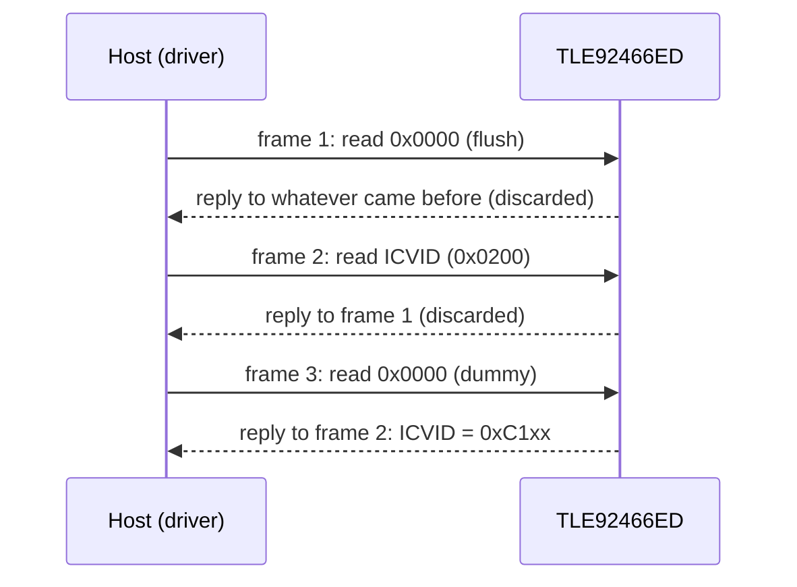

# Hardware

What to connect between your MCU and a TLE92466ED, with which bus settings and supplies, and the board-level
details that decide whether the first frame works.

All values here come from the [TLE92466ED datasheet](datasheet/tle92466ed-datasheet.pdf) (Rev. 1.2, 2022-02-01).
When they disagree with a board's schematic, the schematic wins for pin routing and active levels.

## Host interface pins

| Signal (pin) | Direction | Notes |
| --- | --- | --- |
| CSN (5) | in | Active low; internal pull-up |
| SCK (6) | in | Internal pull-down |
| SI (7) | in | MOSI; internal pull-down |
| SO (9) | out | MISO, push-pull at VIO; tri-state while CSN is high |
| VIO (8) | supply | The MCU's I/O rail, 3.3 V or 5 V |

The SPI inputs accept 3.3 V or 5 V logic (VIH 2 V maximum, VIL 0.8 V minimum); the pull-up
and pull-downs are 10 µA to 50 µA. SO
tri-states within 200 ns after CSN rises, so the chip can share a bus with other devices.

## Control pins

The driver addresses RESN, EN and FAULTN by name (`tle92466ed::CtrlPin`) and by state (`GpioSignal::ACTIVE` /
`INACTIVE`). Your port maps a state to a level, so the same driver code works with inverted or level-shifted
signals.

| Pin (number) | Direction | What it does | Driver use |
| --- | --- | --- | --- |
| RESN (26) | in, active low | Resets every register, all channels off | Pulsed by `Init()`; `HoldReset()`, `ReleaseReset()` |
| EN (27) | in, active high | Enables the outputs; SPI works when low | Set by `Init()`; `Enable()`, `Disable()` |
| FAULTN (11) | open drain, active low | Signals a fault; usable as an interrupt | `IsFault()`; pull it up to VIO |
| DRV0, DRV1 (25, 28) | in | Drive channels in `DIRECT_DRIVE_DRV0/1` | Not driven by the driver |
| CLK (24) | in | External PLL clock, 1 MHz to 8 MHz | `ConfigureClockSource()` |

FAULTN sinks 2 mA at 0.4 V maximum; leave it open if you do not use it. The PLL runs from the internal oscillator or,
with `EXT_CLK` set in `CLK_DIV`, from CLK; fSYS is 28 MHz either way (27.5 MHz to 28.5 MHz).

## Power stage pins

| Channel | LOADx | FWDx | GNDPx |
| --- | --- | --- | --- |
| CH0 | 1 | 2 | 3 |
| CH1 | 18 | 17 | 16 |
| CH2 | 19 | 20 | 21 |
| CH3 | 36 | 35 | 34 |
| CH4 | 31 | 32 | 33 |
| CH5 | 13 | 14 | 15 |

GND is pins 4, 10, 12, 23 and 30, and the exposed cooling tab. Connect every GNDPx to GND externally and the tab to
GND and the heat-sink copper.

## Load connection

Each channel is a low-side switch: connect the load between its supply and LOADx. The current flows through the
internal shunt and the DMOS to GNDPx while the channel is on.

!!! danger "Inductive loads need the freewheeling diode at FWDx"
    The chip has no internal freewheeling diode. For a solenoid or valve, fit a diode from FWDx (anode) to the load
    supply (cathode), as the datasheet's application diagram (section 6) shows. Without it the coil current has no
    path when the switch opens, and the measured average current is wrong.

The datasheet recommends 4.7 nF to 10 nF ceramic capacitors at the load connector and at FWDx. Channels CH0/CH3, CH1/CH2
and CH4/CH5 can be wired in parallel for one load: connect both LOAD pins to the load and both FWD pins to the diode,
and configure the pair as described in [Current control](current-control.md#parallel-channels).

## Bus settings

| Setting | Value |
| --- | --- |
| Mode | SPI mode 1 (CPOL = 0, CPHA = 1): SI sampled on the falling SCK edge, SO shifted on the rising edge |
| Bit order | MSB first, both directions |
| Frame | Exactly 32 bits per CSN low period; any other length is ignored |
| Speed | Up to 8 MHz (fSCK); the examples run at 1 MHz |
| Integrity | CRC-8 SAE J1850 in bits [31:24] of every frame ([SPI protocol](spi-protocol.md#crc)) |
| Reply | Clocked out during the **next** frame |
| Watchdog | Optional SPI watchdog: reload `WD_RELOAD` before it reaches 0 ([Diagnostics](diagnostics.md#spi-watchdog)) |

## Timing

| Parameter | Limit | Meaning |
| --- | --- | --- |
| SCK high, low (tSCKH, tSCKL) | ≥ 50 ns | 8 MHz maximum clock |
| Enable lead (tCSN_LEAD) | ≥ 250 ns | CSN falling to the first SCK rising edge |
| Enable lag (tCSN_LAG) | ≥ 250 ns | Last SCK falling edge to CSN rising |
| Transfer delay (tCSN_TD) | ≥ 600 ns | CSN high time between two frames |
| SI setup, hold (tSI_SU, tSI_H) | ≥ 20 ns | Around the falling SCK edge |
| SO valid (tSO_V) | ≤ 100 ns | 150 pF load |
| SO enable, disable (tSO_EN, tSO_DIS) | ≤ 200 ns | From CSN falling, rising |
| Reset to logic ready (tRESN) | ≤ 0.1 ms | After RESN goes high |
| Power-on reset (tPOR) | ≤ 10 ms | After the supplies are in range |

The transfer delay matters on fast SPI peripherals: two frames sent back to back need CSN high for at least
600 ns between them. `Init()` waits 10 ms with RESN low and 50 ms after release, well above tRESN.

Each arrow is one CSN low period of 32 bits. [SPI protocol](spi-protocol.md) explains the frames and why the
driver sends three of them per access.

## Power

| Supply | Functional | Extended | Abs. max |
| --- | --- | --- | --- |
| VDD (logic, 5 V input) | 4.5 V to 5.5 V | 3.5 V to 19 V | 19 V |
| VBAT (battery) | 6 V to 18 V | 4 V to 38 V | 40 V |
| VIO (SPI output) | 3.0 V to 5.5 V | 5.5 V to 19 V | 19 V |
| LOADx, FWDx | −0.3 V to 40 V | | 40 V |

Outside the VDD functional range SPI still works but the outputs are off. VBAT is monitored and feeds the
diagnosis current sources: reverse-protect and filter it. Select 3.3 V or 5 V VIO monitoring with `VIO_SEL`
(`GlobalConfig::vio_5v`). Negative pulses on LOADx and FWDx are limited to 2 mJ.

| Current | Value | Notes |
| --- | --- | --- |
| DC setpoint, per channel | 0 mA to 1500 mA | Average current control |
| Load current including dither | 1.8 A | |
| Parallel pair | 2.7 A | |
| Absolute maximum, LOADx / FWDx | ±2 A DC | |
| Over-current protection threshold | 2.05 A to 6 A | Filter time 1.5 µs maximum |
| Control accuracy | ±2.5 mA (10 mA to 250 mA), ±1 % above 250 mA | Single channel, TJ up to 150 °C |

Connect the MCU ground to the chip's GND and GNDP pins. Decouple VDD, VIO and VBAT with ceramic capacitors close
to the pins.

## Thermal

| Parameter | Value |
| --- | --- |
| Junction temperature | −40 °C to 150 °C (150 °C to 175 °C with parameter deviations) |
| Over-temperature pre-warning | 150 °C to 175 °C |
| Over-temperature shutdown | 175 °C to 200 °C, 10 °C to 15 °C hysteresis |
| RthJC / RthJA | 3 K/W maximum / 18.5 K/W typical (JEDEC 2s2p) |

## Evaluation kit

Infineon's Next Generation Solenoid Driver evaluation kit has a TLE92466ED evaluation PCB in Arduino form factor
(Version S), or the same PCB with a connection PCB for laboratory setups (Version L). The PCB takes 5 V from the
MCU board, clocks the chip from an on-board 2 MHz oscillator and brings out SPI, EN, RESN, FAULTN and DRVx on the
Arduino headers. The [user manual](datasheet/tle92466ed-eval-kit-user-manual.pdf) has the connector pinouts and
jumpers.

The [ESP32 examples](examples.md) run on an ESP32-S3 wired like this (from
[`esp32_tle92466ed_test_config.hpp`](../examples/esp32/main/esp32_tle92466ed_test_config.hpp)):

| ESP32-S3 | TLE92466ED |
| --- | --- |
| GPIO36 (SPI3 SCLK) | SCK |
| GPIO37 (SPI3 MOSI) | SI |
| GPIO35 (SPI3 MISO) | SO |
| GPIO4 | CSN |
| GPIO6 | RESN |
| GPIO5 | EN |
| GPIO16 (pull-up) | FAULTN |
| GPIO7, GPIO15 | DRV0, DRV1 |

## Reference documents

| Document | What it is for |
| --- | --- |
| [TLE92466ED datasheet](datasheet/tle92466ed-datasheet.pdf) | Pins, electrical limits, SPI protocol, every register |
| [Evaluation kit user manual](datasheet/tle92466ed-eval-kit-user-manual.pdf) | Evaluation PCB connectors, jumpers, schematics |

Next: [Architecture](architecture.md).
