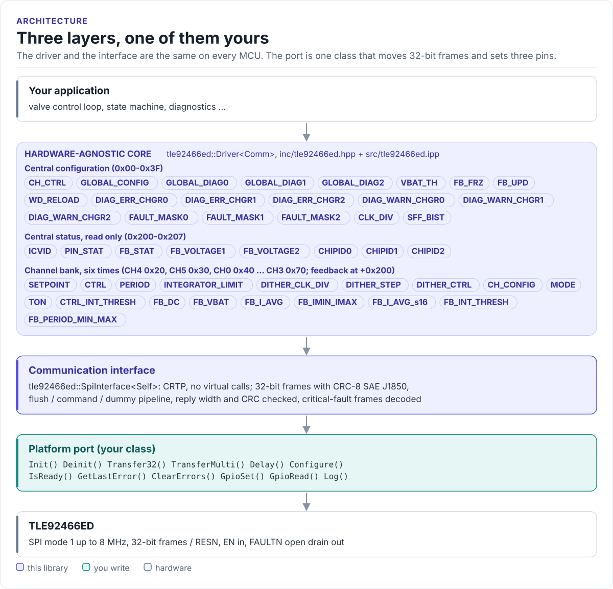

# Porting

Run the driver on a new MCU by writing one class: the SPI interface.

The driver never calls your SDK directly. It calls twelve methods on a class you derive from
`tle92466ed::SpiInterface<Self>` (in [`inc/tle92466ed_spi_interface.hpp`](../inc/tle92466ed_spi_interface.hpp)).
The base class uses CRTP: the calls are resolved at compile time, so there are no virtual functions, no vtable and
nothing to allocate. Frame building, the CRC, the pipeline and reply validation are in the base class; your port
only moves words and toggles pins.

<!-- figure: driver-layers -->
<picture>
  <source media="(prefers-color-scheme: dark)" srcset="diagrams/driver-layers.dark.svg">
  
</picture>
<!-- /figure -->

## What you implement

| Method | Contract |
| --- | --- |
| `Init()` | Bring up the SPI peripheral and the GPIOs. Called first, from `Driver::Init()` |
| `Deinit()` | Release them |
| `Transfer32(tx)` | One full-duplex 32-bit frame, MSB first, CSN low for exactly 32 clocks. Return the received word |
| `TransferMulti(tx, rx)` | `tx.size()` frames in order, one CSN pulse each, without another device's traffic in between |
| `GpioSet(pin, signal)` | Drive `RESN` or `EN` to `ACTIVE` / `INACTIVE` |
| `GpioRead(pin)` | Read `FAULTN` as `ACTIVE` (low) / `INACTIVE` |
| `Delay(us)` | Block for at least that many microseconds (the driver waits up to 50 ms at a time) |
| `Configure(config)` | Apply an `SPIConfig` (frequency, mode) if your port supports changing it; otherwise succeed |
| `IsReady()` | `true` after a successful `Init()` |
| `GetLastError()`, `ClearErrors()` | Your port's sticky error, if it keeps one |
| `Log(level, tag, fmt, va_list)` | Print one line; `Error` ... `Verbose`. Add `using SpiInterface<Self>::Log;` |

Each returns a `tle92466ed::CommResult<T>`; return `tle::unexpected(CommError::...)` on failure. The C++20 concept
`SpiInterfaceLike` checks the core signatures at compile time.

!!! note "Keep the base `Log()` visible"
    The driver calls the base class's printf-style `Log(level, tag, fmt, ...)`. Declaring your own
    `Log(..., va_list)` hides it unless you add `using tle92466ed::SpiInterface<MySpi>::Log;`, and the driver then
    fails to compile.

## The port

```cpp title="my_spi.hpp"
--8<-- "tests/docs/my_spi.hpp:port"
```

## Transfer rules

- **SPI mode 1**, MSB first, at most 8 MHz. Start at 1 MHz.
- **Exactly 32 bits per CSN low period.** The chip ignores a frame of any other length. A 4-byte transfer is fine;
  a 3- or 5-byte one is not.
- **A CSN pulse per frame in `TransferMulti()`**, with CSN high for at least 600 ns between frames
  (t<sub>CSN_TD</sub>). Most SPI drivers that toggle CS per transaction meet this at 1 MHz; check it at 8 MHz.
- **No other device between the frames of one call.** The reply to the command frame comes out during the next
  frame; if another device's transaction runs in between, the reply is lost. On a shared bus take the bus lock
  for the whole `TransferMulti()` call (`spi_device_acquire_bus()` on ESP-IDF, a mutex elsewhere).
- **Bit 31 first.** `Transfer32()` takes and returns the frame as a `uint32_t`; put bit 31 on
  the wire first. On a little-endian MCU with a byte-buffer SPI API that means swapping the bytes, as the port
  above does.
- **Return an error only for a bus failure.** CRC, status and reply-width problems are the base class's job.

## Control-pin levels

| Pin | `ACTIVE` level on the chip | Port mapping on a direct connection |
| --- | --- | --- |
| RESN | Low (reset) | `ACTIVE` writes 0 |
| EN | High (outputs enabled) | `ACTIVE` writes 1 |
| FAULTN | Low (fault) | Pin reads 0: return `ACTIVE` |

Invert the mapping in your port when a buffer or level shifter inverts a signal; the driver code stays the same.
FAULTN is open drain: enable a pull-up on the MCU or fit one to VIO.

## Reference implementation

The ESP32 examples use
[`esp32_tle92466ed_bus.hpp`](../examples/esp32/main/esp32_tle92466ed_bus.hpp): an ESP-IDF `spi_master` port with
one `spi_device_transmit()` per frame, GPIO control for RESN and EN, and `ESP_LOG` output. `TransferMulti()` holds
the bus with `spi_device_acquire_bus()` for the whole chain, so it is safe on a bus shared with other devices. Start
from it for any ESP-IDF target.

## Check your port

1. Build it: the port on this page is compiled by the host CI from [`tests/docs/`](../tests/docs/my_spi.hpp), with
   the driver instantiated over it.
2. Call `Init()`. `DeviceNotResponding` means MISO stayed idle. `WrongDeviceID` with an `ICVID` such as `0x82xx`
   or `0x60xx` (`0xC1` shifted by one bit) means the sampling edge is wrong: check the SPI mode.
3. Read `ReadAllSupplyVoltages()`: a plausible VBAT and VDD prove 22-bit feedback reads end to end.
4. Enable the SPI watchdog with a short `WD_TIME` and stop reloading it: `SPI_WD_ERR` must appear in
   `GetAllFaults()`, which proves writes land.

## Threads

The driver is not thread-safe. Give each TLE92466ED one owner task, or guard every call on a driver object (and its
port) with one mutex. Several chips on separate ports can run in parallel.

Next: [Examples](examples.md).
